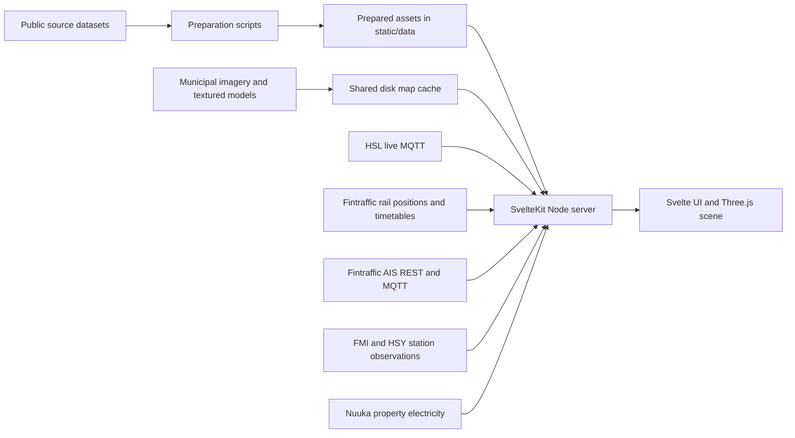

# Helsinki Lens

Helsinki Lens is a 3D view of central Helsinki combining selectable buildings, live HSL trams, buses and ferries, Fintraffic trains, scheduled routes, station weather and air quality, and verified building energy and solar records. It keeps original building identifiers, source attribution and data age visible. Displayed times use `Europe/Helsinki`.

The map covers the prepared release area, WGS84 `[24.86, 60.135, 25.06, 60.225]` in west, south, east, north order. It is a bounded city view, not a complete Finland dataset. Missing readings remain missing; prepared samples never replace live feeds during an outage.

Coverage extends through Lauttasaari, Munkkiniemi, Pasila/Käpylä and Herttoniemi while the opening view remains City Centre. The lower-left scale shows metres or kilometres at the view centre and updates with zoom and rotation. Zooming out reaches an 18 km camera distance; foreground assets still load by view.

## Contents

- [First run](#first-run)
- [How the project works](#how-the-project-works)
- [Using the view](#using-the-view)
- [Shared map cache CLI](#shared-map-cache-cli)
- [Commands and source refresh](#commands-and-source-refresh)
- [Live data and interpretation](#live-data-and-interpretation)
- [HTTP endpoints](#http-endpoints)
- [Configuration, production and releases](#configuration-production-and-releases)
- [Verification and troubleshooting](#verification-and-troubleshooting)
- [Vehicle models](#vehicle-models)
- [Source evidence and development notes](#source-evidence-and-development-notes)

## First run

Use **Node 24 and npm 11**; `.nvmrc` selects Node 24 and `package-lock.json` pins dependencies. Source preparation also requires **Java 17+ and `unzip`**. Its pinned CityGML converter is downloaded into the ignored `.cache/` directory. Blender is only needed to regenerate vehicle models, not to run the application. Use a browser with WebGL for the 3D scene.

Run all commands from the source checkout root:

```sh
npm ci
cp .env.example .env
```

Copy the environment example only if `.env` does not already exist. No upstream credentials are required. Preparation needs internet access to the documented public providers; live operation needs outbound HTTPS and TLS MQTT to `mqtt.hsl.fi:8883`.

A clean checkout does not contain generated datasets. Prepare the complete application in this order:

```sh
npm run data:prepare
npm run city:prepare
npm run energy:prepare
npm run ryhti:prepare
npm run routes:prepare
npm run rail:prepare
npm run entities:prepare
```

Inspect each command's result before continuing. `data:prepare` exit **2** means a usable foundation sample was published with explicit open source gates; inspect `.cache/task-a/latest-preparation.json` and the reported gates. Exit **1** means preparation failed and the previous published sample was retained. Historical foundation gates and the later verified energy catalog have separate evidence; see [data access](docs/data-access.md) and [energy/solar evidence](docs/energy-solar-evidence.md).

`energy:prepare` must run after **every** `city:prepare`, even when the upstream semantic tileset checksum is unchanged. The energy catalog must match the exact prepared city generation. `routes:prepare` uses the HSL GTFS ZIP downloaded by foundation preparation.

Start development:

```sh
npm run dev
```

Open the loopback address printed by Vite. Starting before preparation lets you inspect the application shell, but the map/data remain unavailable until usable assets exist. Optionally run `npm run city:cache` before browsing to prefetch all municipal model detail levels; the app otherwise warms overview coverage automatically.

## How the project works

The application uses Svelte 5/SvelteKit with the Node adapter, a Three.js renderer, and proj4 for coordinates. Exact installed versions are in `package.json` and the lockfile.



Preparation converts and validates source data once, publishes immutable generations, and changes their manifest pointers only after successful publication. A failed refresh retains the previous valid generation. Raw archives, conversion tools and diagnostics live in `.cache/`; generated datasets are ignored by Git.

Browsers load prepared `/data/` geometry and its visible-chunk metadata, then request visible municipal imagery and textured buildings through `/api/city-asset`. The Node server validates and caches these municipal assets on disk for all visitors. Browser Cache Storage is an optional additional cache; it is independent of the server cache and of GPU resources.

Each Node process shares demand-driven HSL and marine MQTT connections and one Digitraffic rail position poll across its browsers, forwarding combined snapshots/updates through SSE. Marine positions also use bounded REST bootstrap/recovery. Station observations and measured electricity use separate server services. A small entity catalog summary supplies themes and source status. Building search, inspection and theme values use SQLite-backed APIs; TanStack Svelte Query caches bounded responses by dataset generation. Run one application process; multiple workers would need shared live-feed coordination.

Geometry uses metres. Source ETRS-GK25/EPSG:3879 coordinates become local Three.js `[east, elevation, -north]` coordinates around longitude 24.952, latitude 60.1695, elevation 0. Heights retain the N2000 datum; projection does not perform a vertical datum conversion. See [data contracts](docs/data-contracts.md) and [coordinate controls](docs/coordinate-controls-evidence.md).

### Repository and stored data

| Location | Purpose |
| --- | --- |
| `src/routes/+page.svelte` | Application shell, data loading, selection, search and inspectors. |
| `src/lib/` and `src/lib/components/` | Scene rendering, asset loading, vehicles, shared records and UI components. |
| `src/lib/data/` | Source decoders, identity reconciliation and GTFS matching. |
| `src/lib/server/` and `src/routes/api/` | Validated upstream access, shared caches and HTTP/SSE endpoints. |
| `scripts/` | Source preparation, map caching, release packaging and explicit verification tools. |
| `tests/` | Regression tests, small attributable source fixtures and browser verification pages. |
| `assets/blender/` and `static/models/` | Editable vehicle models and checked-in GLB exports. |
| `docs/` | Source contracts, coverage/method evidence, operations and dated acceptance results. |
| `static/data/manifest.json` and `static/data/generations/` | Foundation sample pointer and immutable generations. |
| `static/data/city/` | City manifest, terrain/context, semantic geometry and building metadata. |
| `static/data/rail-index.json` | Separate Digitraffic train numbers, active calendars, clipped shapes and ordered stops. |
| `.cache/task-f/` | Ignored marine verifier reports, browser evidence and bounded diagnostics; never raw national AIS payloads. |
| `static/data/route-index.json` | Prepared route labels, trips, shapes and stop patterns. |
| `static/data/energy-manifest.json` and `static/data/energy/` | Energy catalog pointer and immutable catalogs. |
| `server/data/entities/` | Private immutable SQLite generations and their active manifest; rebuilt from prepared data with `entities:prepare`. |
| `.cache/city-map/` | Persistent municipal imagery, tile indexes, textured model bytes and building photographs; configurable. |
| `.cache/energy/runtime/` | Persistent measured-electricity cache; preserve across deployments. |
| `.cache/task-a/`, `.cache/task-b/`, `.cache/task-d/`, `.cache/task-e/` | Source downloads, preparation/verification diagnostics and release artifacts. |
| `build/` and `.svelte-kit/` | Generated production output and SvelteKit tooling output. |

`static/data/energy-refresh-status.json`, when present, records a failed energy refresh. Retain manifest pointers and their referenced generations together. Deleting raw preparation caches forces source reacquisition; deleting prepared assets leaves an unprepared application; deleting runtime caches loses reusable saved responses.

## Using the view

The opening view pairs **A city of connections.** with four exploration groups: **Map**, **Transport**, **Buildings**, and **Energy**. Map starts expanded. Activating a Buildings or Energy theme automatically enables 3D buildings. Buildings and Energy share one active colouring theme; click the active theme again to restore default appearance. Its legend includes units, category counts, filtering and missing-data states.

Exploration sits to the left of the desktop map. A compact top-right display shows Kaisaniemi temperature and wind speed, plus Mannerheimintie NO₂, on every screen size. Click a reading to open its station history; its accessible label and tooltip retain station, source, Helsinki timestamp and freshness. Missing readings show a dash, and retained stale readings are marked. Selecting an object opens its inspector. Building inspection retains the photo, **Overview**, **Details**, register records and attached energy history.

Below 1200px, **Layers** and **Inspect** use one shared panel; **Explore** closes it. Inspect appears only while an object is selected. Below 780px the header uses two rows and the panel becomes a sheet above bottom navigation. Closing an inspection sheet or pressing Escape once preserves selection; **Clear selection** removes it separately. Guided camera cards collapse while a compact panel is open. Use the **Legend** shortcut for expanded legends in the shared panel.

The header **?** opens Help. Project information links remain in the header, inside the **···** menu on compact screens. **Data & sources** opens source status and attribution.
Hold **WASD** to pan across the ground relative to the camera heading; diagonal movement keeps the same speed. Keyboard navigation pauses in interactive controls, while a dialog is open, and when the window loses focus. Moving manually stops vehicle follow. Turn off **WASD navigation** in the header **?** help panel to disable these shortcuts; it starts enabled on each page load.

Choose the numbered **City Centre**, **Harbour** or **Central Station** cards for existing camera views. The header live dot opens separate HSL, rail and AIS statuses and report times. Search has **Vehicles**, **Routes**, **Buildings** and **Stations** tabs. The query filters the selected tab, which is remembered until reload. Lists scroll by mouse, touch or keyboard with the scrollbar hidden. Buildings shows loaded identities with an empty query, searches prepared metadata/addresses when typing, and retains a server-backed list if WebGL is unavailable. Building search requests run only while its tab is open. Search and scene picking use the same selection contract. On desktop, Escape clears selection. Search results, popovers and dialogs handle Escape before the map.
Selecting a building opens its source identifiers and compatible energy/solar records. Selection and hover tint the displayed building, with selection taking precedence. Selecting a vehicle shows its real report age, deviation and exact scheduled journey when available, without moving the camera. Verified routes use an outlined line and stop markers with names on hover, keyboard focus or touch focus. A chevron ahead of the selected vehicle shows a reported heading or a bearing from accepted movement; it pulses while moving and stays static with reduced motion. Unknown direction, stale reports and hidden vehicles suppress the cue. AIS ships have no scheduled route mapping. Following ends when you interact with the camera. Station inspectors show a recent six-hour history without changing current traffic into historical playback. **Data & sources** explains dates, coverage, attribution and gaps. Search/inspection provide a metadata fallback when WebGL is unavailable.

### Map appearance and loading

The default **Aerial imagery** layer uses the municipal 2025 orthophoto and textured LoD2 buildings also used by [Helsinki 3D](https://kartta.hel.fi/3d/). Aerial images follow prepared terrain and sea datum; building transforms preserve calibrated coordinates. Disable imagery for the plain geographic model. Energy themes use compatible semantic building colors, and missing values remain neutral.

The renderer discovers assets for the visible area and changes model detail with the camera distance. Selecting a building requests finer nearby detail. Complete local replacements appear while unrelated downloads continue, and offscreen objects release GPU resources. Downloads have deadlines, byte limits and bounded concurrency; the old fixed 24-imagery/48-model caps no longer apply. The prepared 20 m terrain still limits coastline precision.

Map readiness includes discovery, enabled visible assets, texture decoding and a rendered frame. Missing parts retry with bounded backoff while settled available data remains usable. KTX2 texture decoding uses the Basis transcoder bundled with the pinned Three.js dependency and served locally by Vite.

## Shared map cache CLI

The `city:cache` command warms or rebuilds the **server** cache across the entire prepared area, independent of the current camera or any visitor's browser cache. Prepare city assets first, or keep an existing valid prepared city generation. The command validates prepared geometry/metadata; it does not regenerate city data, energy, routes or live feeds.

| Command | Behavior |
| --- | --- |
| `npm run city:cache` | Download missing aerial cells, tile indexes and models at every detail level across the enlarged prepared area; reuse valid saved assets. |
| `npm run city:cache -- --refresh` | Fetch full-area aerial/index/model coverage again, including coarse models and detailed descendants. |
| `npm run city:cache -- --all-levels` | Compatibility alias for the default full-area cache command. |
| `npm run city:cache -- --all-levels --refresh` | Compatibility alias for `--refresh`. |

To rebuild every zoom level using the server's persistent cache directory, run from the source checkout:

```sh
CITY_MAP_CACHE_DIR=/srv/helsinki/shared/city-map npm run city:cache -- --all-levels --refresh
```

Use the **same absolute directory** in the running app's environment or `.env`:

```dotenv
CITY_MAP_CACHE_DIR=/srv/helsinki/shared/city-map
```

Give the command and application user read/write access to that directory and preserve it across deployments. Without this setting, both use `.cache/city-map` relative to their working directory. Running the CLI in another checkout with the default directory does not rebuild the deployment's cache; point it at the shared directory or transfer its completed cache to the serving host. Use a prepared city matching the deployment's area/generation.

To resume after interruption or source failure, omit `--refresh`:

```sh
CITY_MAP_CACHE_DIR=/srv/helsinki/shared/city-map npm run city:cache -- --all-levels
```

The CLI traverses nested indexes by default, keeps coarse models needed when zooming out, downloads detailed descendants needed when zooming in, excludes out-of-area branches using the current prepared map bounds, and deduplicates asset URLs. `--all-levels` remains accepted for compatibility. Automatic warming in the app still selects overview coverage at 10 m geometric error or finer. `--refresh` requests municipal bytes again without deleting the cache first; failed upstream downloads retain previously saved assets.

Progress uses `discovering`, `loading`, then `complete`, `partial` or `stopped`. A complete run exits **0**; incomplete discovery/downloads, invalid prepared assets, unsupported arguments or storage failure exit nonzero. After fixing connectivity, space or permissions, resume without `--refresh`. Full-detail disk usage and download duration have not been measured and exceed overview caching.

Saved municipal bytes become eligible for revalidation after 30 days, with older validated bytes available during source outages. Automatic warming starts after the first usable view and retains overview behavior. Server upstream work permits four requests, at most two for area warming, with foreground work taking priority. Disk failure stops warming while foreground loading remains operational. `/api/city-cache` reports the running app's warmer, not the separate CLI process's progress. The CLI requires the source checkout and is not shipped as a runnable script in release bundles.

## Commands and source refresh

| Command | Purpose and arguments |
| --- | --- |
| `npm run dev` | Loopback development server; reads `.env` and serves current prepared assets. |
| `npm run data:probe -- --source observations` | Focused source access check; accepts `all`, `geometry`, `energy`, `transit` or `observations`. Without arguments, probes all. |
| `npm run data:prepare` | Publish a validated foundation sample; no source/URL arguments. |
| `npm run city:prepare` | Prepare licensed terrain, context, semantic building geometry and metadata. |
| `npm run energy:prepare` | Publish an energy catalog compatible with the current city. `-- --refresh` retrieves a new source version for review. |
| `npm run routes:prepare` | Build the route index from `.cache/task-a/hsl-gtfs.zip`; optional positional arguments are archive path and output path. |
| `npm run entities:prepare` | Build and atomically publish the private SQLite read database after foundation, city, energy or Ryhti preparation; no source downloads. |
| `npm run city:cache` | Warm the municipal asset cache; see flag combinations above. |
| `npm run check` | SvelteKit sync, TypeScript and Svelte diagnostics. |
| `npm test` | Node regression tests using local fixtures. |
| `npm run build` | Build the production application and prepared static assets into `build/`. |
| `npm start` | Run the built Node server using `.env`. |
| `npm run preview` | Loopback Vite preview of the build; use `npm start` for the deployed Node service. |
| `npm run release:package` | Validate/package an existing build; optional positional argument selects an output parent. |

Probes write `.cache/task-a/probe-<source>.json` and use exit 2 when a checked gate is not passing. They may download and cache sources; they are not a publication command. Normal preparation reuses verified raw caches, so rerunning it does not necessarily retrieve a newer upstream version.

After refreshing city data, prepare matching energy and any published Ryhti snapshot, then run `npm run entities:prepare` before checking/testing/building again. Rebuild the entity database after foundation, energy or Ryhti changes too. A missing optional catalog stays explicitly unavailable; an existing invalid or incompatible catalog fails preparation and retains the previous database. Production static assets require a new build; development reads updated prepared files directly. Do not run simultaneous preparations/builds into the same outputs. Review annual source updates monthly or when providers announce exports; energy preparation intentionally checks known source versions and may reject changed schemas/checksums until reviewed.

For route refresh:

```sh
npm run data:probe -- --source transit
npm run routes:prepare
```

The transit probe reuses its GTFS archive for one hour and also requires a usable real HFP report. Inspect archive retrieval time and feed validity; preparation time does not make an expired feed current. Journey matching reads the prepared index rather than downloading/scanning GTFS on each request.

## Live data and interpretation

### Traffic and scheduled routes

Browsers share one MQTT connection; mode filters do not create separate upstream subscriptions. When all clients close, it is released after a 30-second grace period. Reconnect delays range from 1 to 30 seconds. SSE sends named `snapshot` and `update` events, including removals and feed state; reconnecting clients receive a full snapshot. Hidden tabs close their SSE connection and stop rendering, then recover when shown.

Positions become stale after **30 seconds** and leave the displayed fleet after **120 seconds**, measured from the provider report time. New metadata does not refresh position age. A selected removed vehicle retains an explanation. The app's on-time display band is ±60 seconds; exact HFP deviation remains visible.

Routes are scheduled context. Matching requires complete owner/operator, vehicle, route, direction, service date and start-time identity, including GTFS calendar/DST handling. Missing, expired or ambiguous matches show no guessed route. Raw vehicle positions are never snapped to scheduled shapes.

### Trains and railway stations

**Trains** and **Rail stations** start enabled. Category filters cover commuter, long-distance, freight and other trains. Search accepts train number, public line, destination and station name. Selecting a train shows its timetable, report age, speed, verified route and **Follow train**. Station markers and search open the next 12 passenger departures, refreshed every 30 seconds while visible, with links to available live trains.

The process polls Digitraffic's bounded JSON positions every five seconds while traffic consumers exist. HSL never supplies duplicate commuter-train markers. Provider failures are independent; successful empty snapshots remove rail reports, while failed requests retain them until the normal age limit. Rail movement uses a 12-second buffer of received reports and never extrapolates. Models are representative two-car exteriors; reported horizontal coordinates remain unchanged and terrain height is approximate. Trains without known terrain stay searchable but have no 3D placement.

Rail identity is provider + departure date + train number. Undated reports remain visible without journey linkage. GTFS matching uses the train number and the calendar active on that departure date: Digitraffic's trip-ID date suffix is a timetable period, **not** the departure date. Missing or competing active journeys have no highlighted path. HSL retains its separate matching rules.

Delay belongs to a named timetable event; missing estimates mean unknown delay. Scheduled, estimated and actual times use Helsinki time. Next-stop inference is labelled schedule-based. Failed or old timetable refreshes never change position age. Source outages, fleet age, delayed and unknown-delay counts remain visible.

Refresh the independent rail index daily and after timetable changes, then rebuild production assets:

```sh
npm run rail:prepare
npm run build
```

An offline rebuild may use `npm run rail:prepare -- .cache/rail/gtfs-all.zip`. Its retrieval sidecar is trusted only when the archive checksum matches. Failed preparation preserves the previous index. Rail adds no scheduler or database. See [rail source evidence and verification](docs/rail-evidence.md) for exact limits, attribution and sampled coverage.

### Ships

Ships have their own toggle and remain visible independently of transit route filtering. Search accepts name, MMSI and call sign. Selecting a ship shows its AIS position, broad type, navigation status, motion/quality fields, report age and independent marine source state; it does not request a transit journey. AIS is partial Class A coverage: fishing vessels are filtered upstream, the current map bounds exclude Vuosaari, and an empty local window does not prove the harbour is empty. HSL and AIS vessel identities remain separate, so overlapping reports can appear independently.

Marine positions use a 10-second buffer of received reports for display and never extrapolate beyond the last accepted report. Freshness is measured from the provider's position time: moving or unknown-status ships become stale at two minutes and are removed after ten; anchored/moored ships with valid speed at or below 0.5 knots become stale at ten minutes and are removed after thirty. See [marine contracts](docs/data-contracts.md), [access and source evidence](docs/data-access.md), and [Task F results](docs/milestone-results/F.md) for source clocks, limits and dated verification.

### Weather and air quality

Weather uses Kaisaniemi station **100971**; air quality uses Mannerheimintie station **100742** through FMI/HSY. Requests cover a fixed recent six-hour window. The process shares requests and becomes eligible to refresh weather every five minutes and air quality every fifteen minutes. These intervals are not claims about provider publication cadence.

Each value keeps its actual observed time, provider unit, aggregation and quality. A nearby station is bounded context, not a citywide pollution heatmap or evidence that weather caused a vehicle delay. Dated observations remain visible during provider failures while the process retains them.

### Building energy and solar

The inspector separates **measured property electricity**, **modeled building demand**, and **incident solar energy on modeled roof/wall surfaces**. Exact source identifiers establish links; address/nearest-point guesses are not used. Shared-property consumption is stored once and is never divided into building consumption or used for building colors. Solar irradiation is not installed photovoltaic capacity or electrical output.

The browser requests energy and Ryhti records only for the selected building; theme values arrive in bounded chunk groups. Source summaries retain global ranges, counts and provenance. The full `/api/energy/catalog` and `/api/ryhti/catalog` endpoints remain available for compatibility, but the app does not call them. Daily measured requests accept only catalog-listed properties and the previous twelve completed calendar months. Without a month selection, the service chooses the latest completed month with finite readings for every day; incomplete months retain null gaps and no unqualified total.

Successful measured requests are eligible for refresh after six hours, failures after one minute. Identical lookups coalesce; limits are four concurrent requests, 24 starts/minute, and 256 KiB/15 seconds/366 daily rows per upstream response. Its checksum-validated raw cache has at most 64 disk entries and 64 memory entries at `.cache/energy/runtime`. New month or city/source/membership versions start a new lookup. Provider publication cadence is unknown.

Coverage is incomplete by design. The dated 8 October 2026 release evidence records 8,909 unique buildings, modeled demand for 4,949, solar for 695 in twelve selected district tiles, and one measured property with two exact building matches and one unresolved member. Other solar areas remain unqueried; unknown reference weather year and model settings stay labelled. See [energy/solar evidence](docs/energy-solar-evidence.md), [solar method](docs/solar-method-evidence.md) and [release results](docs/milestone-results/E.md) for measured coverage and performance rather than treating them as live guarantees.

## HTTP endpoints

| Endpoint | Contract |
| --- | --- |
| `GET /api/catalog/status` | Compact coverage, sources, foundation gates, theme metadata and active SQLite generation. |
| `GET /api/entities?generation=...&q=...&kind=building&limit=30&cursor=...` | Accent-insensitive substring search and exact-ID priority; 1–60 buildings per page, opaque next cursor. Optional `theme` plus `category` narrows search. |
| `GET /api/entities/building/:id?generation=...` | One building, its energy/Ryhti records, join evidence and shared-property member identities. URL-encode the original ID. |
| `GET /api/themes?generation=...` | Available theme options, global ranges, categories and counts. |
| `GET /api/themes/:key?generation=...&chunks=...` | Colour/category tuples for 1–16 distinct comma-separated chunk IDs; global colour scale stays fixed while panning. |
| `GET /api/city-asset?url=...` | Validated municipal asset proxy/cache; only approved model paths and bounded aerial requests are accepted. |
| `GET /api/city-cache` | Runtime warmer progress and storage issue; partial warming may trigger a retry. |
| `POST /api/city-cache` | Start/resume automatic overview warming. |
| `GET /api/traffic` | Current vehicle snapshot and dated feed status. |
| `GET /api/traffic/stream` | SSE snapshots, updates, removals, status and 15-second heartbeat. |
| `GET /api/observations` | Fixed station/six-hour observation snapshot; no query parameters. |
| `GET /api/webcams/<stationId>` | Latest reported snapshot time and availability for one of the six fixed Digitraffic cameras; shared one-minute cache, unknown IDs return 404. |
| `GET /api/route` | Prepared route catalog and source validity. |
| `GET /api/route?...` | Exact journey lookup using `ownerOperatorId`, `vehicleId`, `routeId`, `directionId`, `serviceDate` and `startTime`. |
| `GET /api/energy/catalog` | Validated catalog with city compatibility/source status and gzip negotiation. |
| `GET /api/energy?property=...&month=YYYY-MM` | Measured series for a prepared property; `month` is optional. |

Entity endpoints require the generation returned by `/api/catalog/status` and return 409 after a new publication; the client refreshes catalog metadata and retries under new keys. Unknown/duplicate parameters return 400, missing entities 404, oversized responses 413, and missing/incompatible databases 503. Successful responses support ETags, and bodies are capped at 2 MB. Static search covers buildings; compact route labels and live vehicle/station searches retain their existing APIs.

Source-status responses can be HTTP 200 while showing unavailable or dated data. Check the JSON status and report/observation times as well as HTTP/process health. Polling `/api/traffic` itself creates MQTT demand.

## Configuration, production and releases

`dev`, `preview`, `start` and `city:cache` load `.env` through Node's `--env-file-if-exists`. Process-manager environment values override `.env`. The other commands use their documented fixed sources/paths; the project has no API-key variables.

| Variable | Purpose |
| --- | --- |
| `HOST` | Production bind address; `.env.example` sets `127.0.0.1` for a local proxy. |
| `PORT` | Node server port; example/default `3000`. |
| `NODE_ENV` | Example sets `production`. |
| `SHUTDOWN_TIMEOUT` | Graceful shutdown timeout in seconds; example `30`. |
| `PROTOCOL_HEADER` | Set `x-forwarded-proto` only behind a trusted proxy that replaces the header. |
| `CITY_MAP_CACHE_DIR` | Persistent map cache shared by the CLI and app; default `.cache/city-map`. |

To build and run from a prepared source checkout:

```sh
npm run entities:prepare
npm run check
npm test
npm run build
npm start
```

Keep the process working directory at the project or extracted release root so file readers resolve the correct data. Give it access to prepared assets and write permission for both runtime cache directories.

For a transferable release, run `npm run release:package` after building. It checks the private database checksum and source generations, active source checksums, city/energy compatibility, HSL route availability, the validated rail index and equality between prepared data and `build/client/data`. Output lives under `.cache/task-e/releases/helsinki-lens-<version>-<content-hash>/`; `release.json` records file and data checksums. Archive unused old generations before the final build, since the build's static inventory and packaged files must stay consistent.

The bundle includes `build/`, the active private SQLite database and manifest under `server/data/entities/`, npm manifests/lockfile, `.nvmrc`, `.env.example`, dependency notices and documentation. It contains a relative `static/data` symlink to `build/client/data`; preserve it when copying or archiving. It excludes `.env`, credentials, `node_modules`, raw downloads and runtime caches. It serves prepared assets and cannot run source preparation, rebuilds, tests or the cache CLI.

From the extracted release root:

```sh
npm ci --omit=dev
cp .env.example .env
mkdir -p .cache/energy/runtime
npm start
```

Before starting a new release, configure the same persistent `CITY_MAP_CACHE_DIR` and retain `.cache/energy/runtime`, either with the existing shared-directory symlink or by copying its valid cache while the process is stopped. Stop the old single process with SIGTERM, switch to the complete matching new release, and start one replacement. Rollback restores the previous whole release and its environment, retaining runtime caches.

A reverse proxy must leave `/api/traffic/stream` unbuffered and uncached, preserve `Content-Type: text/event-stream`, avoid SSE compression, and allow connections longer than the 15-second heartbeat. For nginx use `proxy_buffering off`, `proxy_cache off`, and `proxy_read_timeout` of at least 60 seconds. The service sends `X-Accel-Buffering: no`. Full proxy configuration, logs, health checks, cache-preserving restarts and rollback are in [operations](docs/operations.md). Public hosting/TLS and distributed scaling are separate from the dated local release verification.

## Verification and troubleshooting

`npm run check` checks TypeScript/Svelte; `npm test` exercises source validation, coordinates, identity matching, cache repair, retry behavior and prepared-data publication with local fixtures. These ordinary tests do not require municipal services to be online. The map-cache tests include all-level traversal, nested/duplicate references, full-area bounds, refresh/resume, retained saved bytes during outages, storage failure and CLI exit status.

For browser/GPU checks:

```sh
npx vite --config tests/city-depth.config.ts
```

Open `http://127.0.0.1:5175/tests/city-depth.html`: it must report `PASS` for 144 camera positions. On the same server, `/tests/building-highlight.html` checks 108 views for tint coverage, selection/hover precedence, clearing and occlusion. Both use local renderer fixtures. Vehicle verification is described below.

The port-camera browser self-check uses fixture media to test switching, refresh failures, visibility cleanup and keyboard/focus behavior. Start the app, open it in a headed Playwright CLI session named `port-cameras`, and zoom out until both harbour signs and Mannerheimintie are visible, then run:

```sh
npx --package @playwright/cli playwright-cli -s=port-cameras run-code --filename=tests/port-cameras.browser.js
```

Check provider playback separately; the self-check deliberately substitutes media and advances the browser clock, so close that session afterwards.

Explicit live verifications are separate from regression tests. `node scripts/verify-traffic.ts` runs the HSL soak; `node scripts/verify-marine.ts --integrated` exercises the shared HSL/rail/marine feed and two in-process SSE readers, with bounded real-provider observation and cleanup. `node scripts/verify-marine.ts --integrated --fixture --peak=<observed-peak> --seconds=300` runs a labelled offline fixture at twice the supplied AIS peak. Marine reports are written under ignored `.cache/task-f/`; they do not store national raw payloads. Results distinguish provider age, server delivery and browser delivery; the in-process verifier does not measure browser/network latency. See [Task F results](docs/milestone-results/F.md) for the recorded scope and any remaining gates, and [release results](docs/milestone-results/E.md) for earlier release/browser evidence.

| Symptom | Check/action |
| --- | --- |
| Empty/unprepared application or unavailable map | Prepare foundation and city assets; inspect manifests and `.cache/task-a/`/`.cache/task-b/` diagnostics. |
| Preparation exits 2 | Inspect reported gates; do not treat a partially evidenced source sample as a fully passing release. |
| Map cache exits `partial` | Inspect reported missing URLs and connectivity; resume without `--refresh`; the CLI includes all model detail levels by default. |
| Map cache exits `stopped` | Check disk space and directory permissions; retain saved assets and rerun after fixing storage. |
| CLI succeeds but deployment downloads assets again | Confirm CLI and app use the same persistent cache directory and matching prepared area. |
| Search/details/themes unavailable after a source refresh | Prepare matching energy and any published Ryhti data, then run `entities:prepare` and rebuild/repackage. Keep the private database with its matching city assets. |
| Route missing or expired | Inspect full journey identity and feed validity, refresh the transit archive/index, then rebuild production. |
| Live traffic disconnected or dated | Check outbound TLS MQTT and SSE/proxy handling; compare provider report times. Missing feeds do not create substitute vehicles. |
| Station readings missing or old | Check FMI access and source status/observed timestamps; refresh timing cannot create unpublished readings. |
| Production serves old or missing static data | Build after preparation and preserve the complete release data/symlink; run from its root. |
| WebGL unavailable | Use metadata search/inspection; the 3D view needs browser/GPU WebGL support. |

Do not clear valid caches as a routine restart or source-outage remedy. Use [operations](docs/operations.md) for recovery of corrupt deployed static assets and source-versus-process health.

## Vehicle models

Bus, articulated tram, double-ended ferry, two-car train and AIS ship exteriors are original Helsinki-inspired Blender models. The editable sources are `assets/blender/helsinki-transit.blend`, `assets/blender/helsinki-train.blend` and `assets/blender/helsinki-ships.blend`; enable one collection at a time. Self-contained GLB exports in `static/models/` are checked in and ship with the normal SvelteKit build. No external textures, model downloads or new runtime dependencies are needed.

Models use metres, with glTF -Z forward and +Y up. Tyres contact Y=0; the ferry hull extends below its Y=0 waterline. Approximate lengths are 12 m, 27.6 m, 36 m and 44.5 m. These are representative exteriors; Live position reports do not identify the exact physical fleet variant or carriage formation. Opaque tinted windows avoid transparency sorting across instanced vehicles. Each model shares three material batches across the entire fleet. Route banners use prepared GTFS labels, retain route IDs when a label is unavailable, and prioritize selected/hovered vehicles when banners overlap. At most 80 non-overlapping banners are displayed; all vehicles remain available through search.

After updating from an older checkout, run `npm run routes:prepare` to include HSL’s extended bus types in the route labels.

AIS reports select passenger (60–69), cargo (70–79), tanker (80–89), tug (31/32/52), fishing (30), sailing (36), pleasure (37), or generic ship models. Representative lengths are 160, 140, 160, 28, 24, 12, 15 and 40 m respectively. Passenger decks, container stacks, tanker piping, tug fenders, trawling gear, sails and yacht cabins distinguish their silhouettes. These are family exteriors, not individual vessel replicas or measured dimensions. Models are centered on the AIS coordinates; the feed does not establish a hull outline or antenna offset.

Ships use the displayed report heading (or course while moving). An unknown heading retains the neutral round marker; pending or failed model loads also retain a selectable marker, with a direction cue only when heading is known. Metadata changes can switch models without resetting position history or selection. All ship variants share the Ships layer control and existing freshness policy.

Regenerate source and exports with Blender 5.2:

```sh
blender --background --python scripts/build-vehicle-models.py
blender --background --python scripts/build-vehicle-models.py -- ships
```

The generator checks geometry and byte budgets and contact/waterline bounds. To inspect the exported assets without live services, run `npx vite --config tests/vehicles.config.ts` and open `http://127.0.0.1:5176/tests/vehicles.html`. It includes a 20 m reference building, individual model views, clickable route banners, stale indicators, individual ship types, an all-types lineup, an unknown-heading marker and an explicit 700-vehicle fixture workload (450 transit vehicles plus the supported 250 ships).

Ship model verification on 10 October 2026 passed type checks, all 317 offline tests, the production build, and side/top visual and selection checks for every variant. The 700-vehicle fixture rendered 5,616,750 triangles in 58 draw calls, with minimum and median 100 FPS across twenty one-second samples at 1440×1000 in Chrome 154 on a Mac Studio M2 Ultra with 64 GiB RAM. This fixture measurement excludes city geometry and does not establish performance on lower-powered devices.

## Source evidence and development notes

Original IDs remain strings, including leading zeroes. Ambiguous joins stay unresolved, missing readings stay null, and observed/report time is separate from retrieval/receipt time. Licensed prepared data keeps provider attribution and source versions. Fixtures and simulated load workloads are explicitly identified; the normal application uses actual live reports.

Use these references when changing adapters, coordinates or deployment behavior:

- [Data access and source gates](docs/data-access.md), [data contracts](docs/data-contracts.md), and [city source evidence](docs/city-source-evidence.md).
- [Rail source evidence and verification](docs/rail-evidence.md).
- [Transit/environment evidence](docs/transit-environment-evidence.md), [geometry/energy evidence](docs/geometry-energy-evidence.md), and [coordinate controls](docs/coordinate-controls-evidence.md).
- [Energy/solar sources](docs/energy-solar-evidence.md) and [solar method/export](docs/solar-method-evidence.md).
- [Operations](docs/operations.md) and dated milestone results: [foundation](docs/milestone-results/A.md), [city/traffic](docs/milestone-results/B.md), [inspection](docs/milestone-results/C.md), [energy](docs/milestone-results/D.md), [release](docs/milestone-results/E.md).
- [Implementation plan](docs/implementation-plan.md) and the milestone specifications in `docs/milestones/` for the original acceptance criteria.

ExcelJS's UUID override is scoped to 11.1.1 for GHSA-w5hq-g745-h8pq; its workbook write/read regression covers the existing CommonJS usage. Keep the lockfile and installed versions aligned when changing dependencies. Capacity, source availability and browser behavior beyond the recorded verification remain workload/device dependent; full-detail municipal cache size is still unmeasured.

## Traffic cameras

Six teal camera signs mark Kivihaka mast, Ilmala, Ruoholahti, Lauttasaari, Kivihaka west and Munkkiniemi. Zoom out from City Centre to see them; they remain visible independently of weather and air-quality layers. Click or use Tab, Enter and Space to open a centered camera modal while retaining the inspector selection. Escape, the close button or a backdrop click dismisses it and restores focus.

The modal loads the full-resolution JPEG directly from Digitraffic, with Fintraffic / CC BY 4.0 credit and the reported snapshot time in Helsinki time. Metadata refreshes every ten minutes while open and visible; images reload only when the reported timestamp advances. Reports older than thirty minutes, or a retained image after a refresh failure, show a stale notice. These are periodic snapshots, not video. No API key or dataset preparation is needed. The [camera research](docs/webcam-integration-research.md) records coordinates, preset IDs and source limitations.

Two IP/CCTV camera signs open the Port of Helsinki viewer: South Harbour selects its video and West Harbour selects the Terminal 2 video. The grouped chooser includes all six official views, with Vuosaari labelled outside the map area. Harbour markers represent access locations rather than exact camera positions, and opening or switching views preserves the inspector selection.

Port videos use permanent provider players in privacy-enhanced mode with autoplay off. Only the selected player loads; it is removed on switching, closing or hiding the page. The three snapshots load directly from the Port with its one-minute cache-busting refresh, pausing while hidden. Failed refreshes retain the previous image with a notice. Displayed image-load time is separate from the unknown capture time. Every view includes a linked Port source, and no Port media is relayed or saved by the app.

## Building photographs

The inspector loads an optional Wikimedia Commons photo independently of building facts. Wikidata's [VTJ-PRT (P3824)](https://www.wikidata.org/wiki/Property:P3824) and [Helsinki RATU (P8355)](https://www.wikidata.org/wiki/Property:P8355) properties provide exact source-ID matches. Conflicting items or identifiers, missing photos, unsupported licenses and missing attribution leave the image absent. No address or proximity guesses are used.

The photo includes its author, license and Commons source link. Supported licenses are CC BY, CC BY-SA and public domain. Photos are shown without cropping; the server downloads and saves Wikimedia image bytes, and the browser loads them from the local building-photo endpoint. Coverage depends on Wikidata and Commons and is strongest for documented landmarks; the photo does not establish a building's current appearance.

`GET /api/entities/building/<id>/photo?generation=<generation>` uses the same building/generation validation as other entity queries. Each process permits two upstream lookups at a time, bounds metadata responses to 256 KiB and ten seconds per request (twelve seconds for the complete lookup), and caches at most 512 ID pairs. Matches and misses last one day and are saved on disk; upstream failures retain an existing photo and retry after five minutes, including after a process restart. `GET /api/entities/building/<id>/photo/image?generation=<generation>` serves checksum-verified JPEG, PNG or WebP bytes with ETags and a one-day browser cache. Image downloads are limited to two at a time, 4 MiB each and fifteen seconds, with redirects disabled. Valid images are reused by their source URL; corrupt cache files are repaired. Image bytes and metadata live under `building-photos/` inside `CITY_MAP_CACHE_DIR` (default `.cache/city-map/building-photos`); preserve this directory across deployments. Only the server requires outbound HTTPS to Wikidata, Commons and Wikimedia image hosts. No dataset preparation or API key is needed.

## Ryhti building register

`npm run ryhti:prepare` prepares open Syke / Ryhti building and permit records for the current city's retained VTJ-PRT identifiers. Run it after city preparation and before the production build. Normal preparation reuses checksum-verified source snapshots; `npm run ryhti:prepare -- --refresh` retrieves both collections again. A failed run retains the previous publication and records its failure. A city-generation mismatch makes enrichment unavailable until preparation runs again.

The inspector shows completed-building register facts separately from municipal geometry attributes, with a list of linked permits. Completion date is not asserted to be the original construction year. Permits can describe historical work; their proposed attributes never overwrite completed-building facts. Exact ambiguous or conflicting associations are withheld. Missing identifiers do not trigger address or proximity matching.

Building colors include Use, Heating method, Heating energy source and Permit action status. Selecting a legend category highlights its buildings and narrows building search; other buildings remain dimmed and pickable. Changing color mode clears this selection. Multiple permit statuses remain explicitly mixed. No linked permit records is not evidence of no construction. Sources & status shows coverage, attribution and snapshot dates.

`GET /api/ryhti/catalog` accepts no parameters, validates the immutable catalog and city-manifest checksum, and reports ready/stale/unavailable. It supports gzip and loads after scene readiness. Existing installations without a Ryhti snapshot remain operational. Release packaging verifies optional Ryhti assets when present. No runtime upstream requests or automatic refresh are added.

The [Ryhti source evidence](docs/ryhti-evidence.md) records measured coverage, limitations and code-list provenance. Syke requires an application identifier for long-term API use; the operator should request it from Syke GIS support as described in the [official instructions](https://ryhti.syke.fi/en/front-page/services/instructions-for-using-open-interfaces-in-the-ryhti-system/). No application identifier has been requested by this integration.
