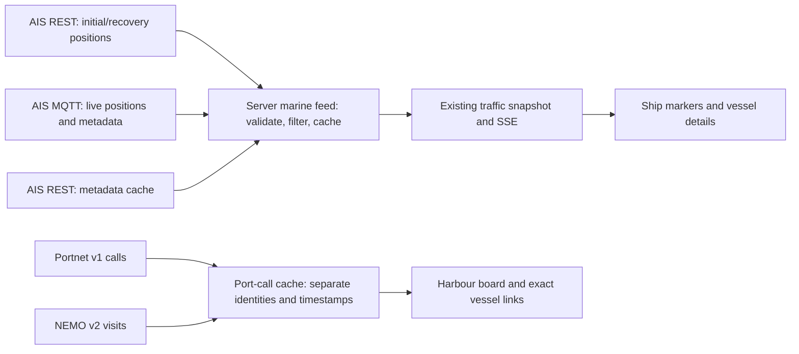

# Digitraffic marine integration feasibility

Research date: 9 October 2026. Scope: Helsinki harbour vessel observations and port calls beyond the HSL ferry feed. This report distinguishes verified upstream facts from proposed application policy. No marine application code is implemented by this research.

## Assessment

**Feasible and useful for an observed marine traffic layer, with port schedules as separate context.** AIS can add commercial ferries, cruise/cargo ships, tankers, tugs and other reporting vessels. It cannot provide a complete harbour inventory. The immediate implementation risk is incorrect time/freshness handling; the immediate schedule risk is the Portnet-to-NEMO transition already underway.

Digitraffic publishes Class A AIS messages only, filters all fishing vessels (ship type 30), and collapses several type ranges to broad categories: 60 passenger, 70 cargo, 80 tanker, etc. Absence from this feed cannot establish absence from the harbour. [Fintraffic AIS filtering](https://www.digitraffic.fi/en/marine-traffic/ais/)

**Recommendation:** reuse the existing server traffic stream for a REST-seeded, MQTT-updated ship layer, then add a separate harbour board backed by both Portnet and NEMO. The live probes below verified anonymous access and real local data. The options table and repository scope below distinguish a 2–3-day periodic layer from a 4–6-day live integration.

## Verified API contracts

Production REST base: `https://meri.digitraffic.fi`. The live [OpenAPI document](https://meri.digitraffic.fi/swagger/openapi.json) and [Swagger UI](https://meri.digitraffic.fi/swagger/) are the contracts to recheck before implementation. Official upstream source below is pinned to commit `22a6d5c0ea75f181fdb41f4df7e0952f6abd0cbb`; source inspection supports the contract but does not independently prove that exact commit is deployed.

| Data | Endpoint and relevant contract | Integration consequence |
|---|---|---|
| Latest positions | `/api/ais/v1/locations`; GeoJSON FeatureCollection, Point coordinates `[longitude, latitude]`, properties include MMSI and motion fields. Filters: `mmsi`, `from`, `to`, or all of `latitude`, `longitude`, `radius` (kilometres). Circle search cannot combine with MMSI. | Fetch a bounded Helsinki circle and apply the product's exact geographic bounds locally. |
| Vessel metadata | `/api/ais/v1/vessels` returns an array; `from`/`to` filters. `/api/ais/v1/vessels/{mmsi}` returns one object or 404. | Join separately by MMSI; a position should remain usable with unknown name/type when metadata is absent. |
| Portnet calls | `/api/port-call/v1/port-calls?locode=FIHEL&…`; `{dataUpdatedTime, portCalls:[…]}`. | Keep a call entity, not just a ship entity: one ship has multiple visits. |
| Port metadata | `/api/port-call/v1/ports/FIHEL`; port areas/berths and their codes. `/api/port-call/v1/vessel-details` and `/code-descriptions` provide separate metadata. | Resolve berth/area labels using this catalogue; do not assume berth codes are geographic coordinates. |
| NEMO pilot visits | `/api/port-call/v2/visits?portOfCall=FIHEL&…`. | A distinct source/schema is needed during migration. |

AIS `from` and `to` are epoch **milliseconds**. Omitted `from` defaults to the preceding 24 hours, including on the metadata list. REST AIS responses have one-minute cache policy. These endpoints return latest records; applying a historical interval does not turn them into a track history service. [AIS controller](https://github.com/tmfg/digitraffic-marine/blob/22a6d5c0ea75f181fdb41f4df7e0952f6abd0cbb/src/main/java/fi/livi/digitraffic/meri/controller/ais/AisControllerV1.java), [latest-location model keyed by MMSI](https://github.com/tmfg/digitraffic-marine/blob/22a6d5c0ea75f181fdb41f4df7e0952f6abd0cbb/src/main/java/fi/livi/digitraffic/meri/model/ais/VesselLocation.java), [GeoJSON coordinate definition](https://github.com/tmfg/digitraffic-marine/blob/22a6d5c0ea75f181fdb41f4df7e0952f6abd0cbb/src/main/java/fi/livi/digitraffic/meri/dto/geojson/Point.java)

### Timestamp units: preserve four separate clocks

| Payload | Field | Meaning / conversion |
|---|---|---|
| REST location | `properties.timestampExternal` | Location record time, epoch milliseconds; use this for observation age. |
| REST location | `properties.timestamp` | AIS UTC **second within a minute**, normally 0–59; 60–63 are status codes. Never use as an epoch. |
| REST vessel metadata | `timestamp` | Metadata record time, epoch milliseconds. |
| MQTT v2 location | `time` | Epoch **seconds**, multiply by 1,000 exactly once. |
| MQTT v2 metadata | `timestamp` | Epoch **milliseconds**, no multiplication. |
| MQTT status | `updated` | Epoch **seconds**, feed heartbeat/data update indicator. |
| Port calls/visits | Event, update and receipt timestamps | ISO 8601 instants; event time and record update time are different facts. |

Store normalized `positionObservedAt`, `metadataUpdatedAt`, `receivedAt` and `feedUpdatedAt` separately. A fresh heartbeat or metadata message must not rejuvenate an old position. Treat REST `timestampExternal` as the documented record timestamp, not a guarantee of the exact GNSS measurement instant. [REST location fields](https://github.com/tmfg/digitraffic-marine/blob/22a6d5c0ea75f181fdb41f4df7e0952f6abd0cbb/src/main/java/fi/livi/digitraffic/meri/dto/ais/v1/VesselLocationPropertiesV1.java), [REST metadata fields](https://github.com/tmfg/digitraffic-marine/blob/22a6d5c0ea75f181fdb41f4df7e0952f6abd0cbb/src/main/java/fi/livi/digitraffic/meri/dto/ais/v1/VesselMetadataJsonV1.java), [MQTT location conversion](https://github.com/tmfg/digitraffic-marine/blob/22a6d5c0ea75f181fdb41f4df7e0952f6abd0cbb/src/main/java/fi/livi/digitraffic/meri/dto/mqtt/MqttVesselLocationMessageV2.java), [MQTT metadata conversion](https://github.com/tmfg/digitraffic-marine/blob/22a6d5c0ea75f181fdb41f4df7e0952f6abd0cbb/src/main/java/fi/livi/digitraffic/meri/dto/mqtt/MqttVesselMetadataMessageV2.java)

### MQTT/WebSocket

Use TLS MQTT over WebSocket at `wss://meri.digitraffic.fi:443/mqtt` with `vessels-v2/+/location`, `vessels-v2/+/metadata`, and `vessels-v2/status`. MMSI comes from the topic, unlike REST properties. The documentation's topic summary incorrectly uses plural `/locations`; its examples and the official publisher use singular `/location`. The topic hierarchy exposes MMSI filtering, not a Helsinki geographic topic, so filter received coordinates locally. Close inactive connections and include status subscription for quiet vessel sets. [Marine MQTT documentation](https://www.digitraffic.fi/en/marine-traffic/#mqtt-websocket-apis), [official publisher topic constants](https://github.com/tmfg/digitraffic-marine/blob/22a6d5c0ea75f181fdb41f4df7e0952f6abd0cbb/src/main/java/fi/livi/digitraffic/meri/controller/reader/VesselLocationRelayListenerV2.java)

New work should use v2 topics. The official 2022 migration thread announced replacement of old topics; its early blanket statement about seconds is superseded by the current metadata-millisecond documentation and implementation. Likewise avoid legacy REST `/api/v1/locations*` and `/api/v1/port-calls*`, announced for removal after April 2023. [MQTT migration thread](https://groups.google.com/g/meridigitrafficfi/c/POq27ruHNr0), [REST migration notice](https://www.digitraffic.fi/en/news/2022/11/09/new-apis-and-deprecations-en.html)

## Port calls: useful, but not vessel presence

Portnet `portCallId` is the call identifier; `mmsi` and `imoLloyds` identify the vessel when available. `portAreaDetails[]` contains ETA/ETD/ATA/ATD plus separate update timestamps, sources, area and berth names/codes. Keep multiple area records. Do not use AIS `destination` text as a reliable port identifier. [Call schema](https://github.com/tmfg/digitraffic-marine/blob/22a6d5c0ea75f181fdb41f4df7e0952f6abd0cbb/src/main/java/fi/livi/digitraffic/meri/dto/portcall/v1/call/PortCallJsonV1.java), [port area/event schema](https://github.com/tmfg/digitraffic-marine/blob/22a6d5c0ea75f181fdb41f4df7e0952f6abd0cbb/src/main/java/fi/livi/digitraffic/meri/dto/portcall/v1/call/PortAreaDetailsJsonV1.java)

Portnet `from`/`to` select record receipt/modification time, not scheduled arrivals. Use `etaFrom`/`etaTo`, `etdFrom`/`etdTo`, `ataFrom`/`ataTo`, or `atdFrom`/`atdTo` for event windows. Filters combine, so an arrivals-or-departures board needs separate queries and union by call ID rather than requiring both events in one window. Narrow results: above 1,000 items the API errors instead of offering a complete paginated response. Upstream explicitly warns that syntactically valid dates may be anomalous, including distant-future dates. [Portnet controller](https://github.com/tmfg/digitraffic-marine/blob/22a6d5c0ea75f181fdb41f4df7e0952f6abd0cbb/src/main/java/fi/livi/digitraffic/meri/controller/portcall/PortcallControllerV1.java), [event filter implementation](https://github.com/tmfg/digitraffic-marine/blob/22a6d5c0ea75f181fdb41f4df7e0952f6abd0cbb/src/main/java/fi/livi/digitraffic/meri/service/portcall/v1/PortCallWebServiceV1.java)

**Current migration gap:** Traficom's 30 September 2026 notice says public Portnet schedules omit NEMO pilot organisations' visits between 1 October 2026 and 1 January 2027. It directs consumers to supplement the new NEMO public interfaces. Mandatory NEMO use begins 1 January 2027; existing public schedule services are due to close in early 2027. A Portnet-only board would knowingly omit part of today's schedule. [Traficom current transition notice, section “Satamakäyntitietojen julkiset kyselypalvelut”](https://www.traficom.fi/fi/uutiset/nemo-jarjestelma-kayttoonotetaan-1102026-pilottiorganisaatioiden-osalta-maarayksia-julkaistu), [Fintraffic deployment schedule](https://www.emsw.fi/en/blog/changes-nemo-deployment-schedule)

NEMO v2 uses string `visitId`, nullable seven-character IMO `vesselId`, nullable `vesselName`, `portOfCall`, `updateTime`, event timestamps, and status. It does not expose MMSI in the inspected VisitModel. Query statuses are `expected-to-arrive`, `arrived`, `departed`, `cancelled`; response enum labels are `Expected to Arrive`, `Arrived`, `Departed`, `Cancelled`. `fromDateTime` is inclusive and `toDateTime` exclusive, documented against any ETA/ETD/ATA/ATD. The live spec declares an object response although the endpoint is plural; validate actual response shape rather than generating a blind client from this declaration. [Live OpenAPI, Port Call V2 and VisitModel](https://meri.digitraffic.fi/swagger/openapi.json)

Proposed join policy: namespaces `portnet:<portCallId>` and `nemo:<visitId>`; connect calls to AIS by valid IMO or MMSI with conflict checks. Do not merge separate visits on vessel name alone. A scheduled ship without a recent observation belongs in the schedule panel, not at an invented position on the map. During transition show each source and its freshness; reconcile duplicates only when identity, port and event interval agree.

## Validation before rendering or animation

Upstream's basic message validator only requires geometry and an MMSI between zero and one billion. It is not enough for rendering. Add validation at the application boundary. [Upstream AIS validator](https://github.com/tmfg/digitraffic-marine/blob/22a6d5c0ea75f181fdb41f4df7e0952f6abd0cbb/src/main/java/fi/livi/digitraffic/meri/dto/ais/external/AISMessage.java)

| Field | Required handling |
|---|---|
| MMSI | Validate numeric integer/nonzero range and canonical nine-digit representation, including topic parsing; preserve namespace and source. Check metadata joins for collisions/conflicts. |
| Position | Reject missing/nonfinite/out-of-world values and AIS unavailable `lon=181`, `lat=91`; then apply Helsinki bounds. |
| SOG | Already knots; `102.3` is unavailable, `102.2` is a capped high value, not a credible harbour animation speed. Convert valid knots to m/s with `1852/3600` if needed. |
| COG | Valid `[0,360)` degrees; `360` unavailable. |
| Heading | Integer `0–359`; `511` or missing means unknown. Do not render 511 degrees or silently interpret unknown as north. |
| ROT | `-128` unavailable; remaining values are encoded, not degrees/sec. Skip ROT animation in the first version. |
| AIS position second | 60 unavailable; 61 manual; 62 estimated/dead reckoning; 63 inoperative. Flag uncertainty; do not animate an inoperative position. |
| Metadata | Blank/@-padded name/callsign/destination and IMO zero are unknown. Draught is decimetres: zero unknown, 255 means at least 25.5m. Zero reference dimensions are unknown. |
| AIS ETA | Packed month/day/hour/minute, no year; not epoch time. Prefer port-call ISO event times for the arrivals board. |

Field facts come from the [US Coast Guard Class A AIS specification summary](https://www.navcen.uscg.gov/ais-class-a-reports) and the [Digitraffic REST field declarations](https://github.com/tmfg/digitraffic-marine/blob/22a6d5c0ea75f181fdb41f4df7e0952f6abd0cbb/src/main/java/fi/livi/digitraffic/meri/dto/ais/v1/VesselLocationPropertiesV1.java). Rendering choices are application proposals. Avoid blindly enforcing generated OpenAPI enums: its `posAcc`/`raim` booleans currently contain an erroneous `[false,false]` enum despite documented true/false semantics.

Normal Class A transmission can be every three minutes at anchor, so a transit-style 30-second stale rule would mislabel legitimate stationary reports. Use the proposed marine freshness policy in the solution section below and tune it with longer local observations; no timing threshold establishes vessel presence. The MQTT v2 payload omits the raw AIS second/status field, so its manual/estimated/inoperative codes cannot be checked on MQTT messages alone. Do not invent an accuracy flag when it is absent. [USCG reporting cadence](https://www.navcen.uscg.gov/ais-class-a-reports), [MQTT location fields](https://github.com/tmfg/digitraffic-marine/blob/22a6d5c0ea75f181fdb41f4df7e0952f6abd0cbb/src/main/java/fi/livi/digitraffic/meri/dto/mqtt/MqttVesselLocationMessageV2.java)

For a REST-only first version show reported positions with short visual transitions, without predicting movement for the whole polling interval. For MQTT interpolate only ordered, validated observations with a bounded delay; reject older updates and implausible jumps, stop at the last observation when updates stall, and break trails over gaps. Heading may orient a stationary hull; COG should orient motion only when speed is meaningful. Preserve the AIS antenna/reference point offset when later using measured ship dimensions. A broker heartbeat indicates connectivity, not that every ship is reporting.

## Access and attribution

Use HTTPS and compression (`Accept-Encoding: gzip`); requests without compression can receive 406. Send a non-personal `Digitraffic-User`, for example `HelsinkiDT/Marine 1.0`, and identify MQTT clients with the application name plus unique suffix. Without the header, documented limits are 60 requests/minute/IP for general and marine v1 REST, five requests/minute/IP for MQTT. The higher identified-user quota is not published; do not infer unlimited access. Respect caches and 429s, back off with jitter, and use conditional requests when the response supplies a suitable validator. [Fintraffic API instructions](https://www.digitraffic.fi/en/support/instructions/)

The data uses CC BY 4.0, including commercial reuse with credit. Link Fintraffic/Digitraffic and the license, preserve required notices, and identify transformations. Suggested UI copy: “Marine data: Fintraffic / Digitraffic, CC BY 4.0. Filtered to Helsinki; positions interpolated for display.” Omit the interpolation claim when not used. [Fintraffic terms](https://www.digitraffic.fi/en/terms-of-service/), [CC BY 4.0](https://creativecommons.org/licenses/by/4.0/)

## Fit with the current Helsinki Lens code

This assessment used the working tree on 9 October 2026, including its uncommitted rail integration. Existing edits were left intact. The suggested filenames below are implementation scope, not files changed by this research.

| Existing seam | Reuse and required change |
|---|---|
| `src/lib/server/traffic.ts`, `traffic-stream.ts`; `/api/traffic` and `/api/traffic/stream` | Reuse one feed per Node process and bounded snapshots/SSE fan-out. Add marine lifecycle, latest-state map, removals and independent source status alongside HSL/rail. A marine outage must not blank working transit. |
| `src/lib/server/rail-feed.ts`, `rail.ts`, `io.ts` | Follow the existing source adapter and bounded HTTP/cache pattern. `mqtt` 5.16.0 is already installed; no additional runtime dependency is required for the proposed transport. |
| `src/lib/types.ts`, `traffic.ts` | Add an explicit ship mode and marine metadata. Use namespaced `ais:<mmsi>` string identities. Make the absence of a transit journey explicit, including nullable route identity where needed, and update affected callers rather than inventing HSL routes. Position time, local receipt time and metadata update time remain distinct. |
| `src/lib/live-fleet.ts`, `scene.ts`, `components/CityScene.svelte` | Reuse projection, picking, instancing and received-position buffering; add ships at the water surface. Current mode enumerations need updating. Freshness currently uses global 30-second stale / 120-second removal limits, and non-train interpolation uses a 1.2-second buffer / 10-second gap limit. Marine needs its own policy across server expiration, motion, rendering and UI. |
| `src/lib/vehicle-flags.ts`, `inspection.ts`, `src/routes/+page.svelte` and route-selection callers | Add ship names, type, source, reporting age and an accessible ships toggle/details view. Vessel selection should open marine details rather than issue an HSL GTFS route request or show transit delay. A port-call panel is a subsequent feature. |
| `src/lib/vehicle-models.ts` | Existing model validation limits length to 60 m and width to 15 m. Large ships cannot simply use that loader unchanged. Start with deliberately schematic water-surface markers; if accurate hulls follow, give marine assets appropriate validation instead of weakening every vehicle's limits. |
| `src/lib/area.ts`, city asset preparation/cache | Current bounds are `[24.86, 60.135, 25.06, 60.225]`. These cover central harbours but exclude Vuosaari. Keep collection bounds separate from visible scene bounds; full-port geometry/camera/cache expansion is additional work. |
| `tests/traffic.test.ts`, `live-fleet.test.ts`, `vehicle-flags.test.ts`, scene/route tests; new marine fixtures/tests | Verify source isolation, timestamp units, null/sentinel handling, out-of-order reports, stale/removed transitions, reconnect recovery and selection without GTFS. Update exhaustive mode records and fixtures. |
| `README.md`, `docs/data-contracts.md`, `docs/data-access.md`, `docs/operations.md`, source attribution | Document source/version, units, coverage, connection/cache limits, health reporting and the Portnet/NEMO transition. Only this feasibility report is added now. |

No dependency internals are assumed here: reuse is based on the application's existing MQTT calls and current package manifest.

## Solution choices and effort

These are engineering estimates for one developer familiar with this repository, including focused tests and UI wiring. They are not measured delivery commitments; bounds expansion, custom ship assets and a prolonged acceptance observation are excluded.

| Option | User-visible result | Transport and scope | Estimated effort |
|---|---|---|---|
| A. Periodic vessel layer | Ship markers, names/types and last report age; visibly periodic updates | Server-side geographic REST snapshot about once a minute, metadata cache, existing SSE delivery. Avoid smooth-looking long-gap movement. | 2–3 working days |
| **B. Live vessel layer — recommended** | Positions update when AIS reports arrive, with safe short interpolation and source/freshness states | REST bootstrap/recovery + one server MQTT connection; cached metadata; shared traffic SSE; schematic ship markers within current city bounds. | 4–6 working days total |
| C. Harbour context, added to B | Arrival/departure board, linked vessel details, port area/berth labels and cancelled/unknown states | Poll and normalize Portnet v1 plus NEMO v2, preserve provider IDs and event revisions, conservative identity matching. | +3–5 working days |

Choose **B first, then C**. A is useful if a quick static enrichment is the priority, but minute-scale REST polling does not support credible continuous ship animation. Do not create a separate database, message broker or historical replay system for the initial live layer.

Recommended flow:

Implementation sequence for B:

1. Subscribe to live updates and fetch a recent geographic REST snapshot; merge by vessel record time so an older bootstrap cannot overwrite a live update. Repeat a snapshot on reconnect. A late or invalid position never advances freshness; metadata never refreshes position age.
2. Keep bounded latest state for the collection area, remove vessels that leave the display area, expire missing reports locally, and fan out only local records. The documented MQTT topics have no geographic component, so wildcard collection receives traffic outside Helsinki. Start with one connection per active Node process and stop it after the existing idle grace period; multiple deployment replicas require an explicit connection budget.
3. Bootstrap/cache metadata and update it independently. An unknown vessel remains visible under its MMSI if its position is valid; batch or rate-limit metadata misses. Do not wait for a name before displaying a ship.
4. Start with schematic, selectable markers and a separate Ships filter. Show broad source ship categories, not invented tanker cargo, routes, occupancy, emissions or punctuality.
5. Preserve separate AIS and HSL identities. If an HSL ferry appears in AIS, suppress a duplicate only after a reviewed owner/vehicle-to-MMSI association. Never merge by proximity or name alone. Prefer the HSL position for a verified overlapping ferry while attaching AIS metadata; unresolved overlap remains explicit.

Proposed display policy, to tune with longer observations: mark moving/unknown-status ships stale after 2 minutes, moored/anchored ships with low reported speed after 10 minutes; remove their scene markers after 10 and 30 minutes respectively while retaining a labelled last-seen detail if useful. These are product choices, not Fintraffic guarantees. Use a short buffer tuned to observed moving-report cadence and interpolate only between plausible received positions. Freeze at the last report, respect reduced motion, and snap rather than cross a large temporal/spatial gap. Reject implausible displacement as a quality issue instead of animating it. Unknown heading must not silently imply a real north-facing bow; course is a fallback only when valid and the vessel is moving.

For C, a call is a visit, not a vessel. Preserve Portnet `portCallId` and NEMO `visitId` in distinct namespaces. Link to AIS only on valid exact MMSI or a unique, consistent IMO association; leave conflicting, absent or multiple matches unresolved. A shared IMO alone does not prove two visits are duplicates. Keep both provider records when a cross-source visit match is uncertain, and avoid double-counted totals. Do not turn an ETA into a vessel position, and do not place a ship at a berth without separate verified berth geometry. Show ETA/ETD as estimates and ATA/ATD as source-reported actuals, with event update times and origin; AIS destination/ETA is merely supplementary vessel-entered information.

## Bounded live evidence from 9 October 2026

All requests were read-only and anonymous, with `Digitraffic-User: HelsinkiLens/1.0` and gzip for REST. REST probes used a 30-second timeout; metadata/port probes capped downloads at 8 MiB. MQTT stopped after 30 seconds, with 5,000-message / 2-MiB aggregate / 32-KiB individual payload limits. Raw responses were inspected in temporary files, not added to application fixtures. These are one-off observations, not availability, completeness or latency guarantees.

| Probe | Time/reference | Observed result |
|---|---|---|
| [AIS positions, 15-km circle](https://meri.digitraffic.fi/api/ais/v1/locations?latitude=60.18&longitude=25.0&radius=15) | HTTP Date `2026-10-09T19:56:17Z`; same collection `dataUpdatedTime` | HTTP 200; 21,373 decoded bytes; 51 positions / 51 MMSIs. The default query can include positions up to a day old. |
| Local bounds filter | Same response and HTTP Date as age reference | 43 positions inside current bounds: 13 at most 30 seconds old, 30 at most 120 seconds, 41 at most 10 minutes. Eleven heading values were 511, three courses 360, and eleven turn rates −128. These sentinels occur in real local data. |
| [AIS metadata](https://meri.digitraffic.fi/api/ais/v1/vessels) | HTTP Date `2026-10-09T19:56:55Z`; default last-day query | HTTP 200; 269,508 decoded bytes; 826 records. Exact MMSI joins covered 50/51 circle positions and 42/43 positions inside the scene. One missing metadata match did not invalidate its position. |
| [FIHEL Portnet calls](https://meri.digitraffic.fi/api/port-call/v1/port-calls?locode=FIHEL&etaFrom=2026-10-08T00%3A00%3A00Z&etaTo=2026-10-12T00%3A00%3A00Z) | HTTP Date `2026-10-09T19:57:20Z`; collection updated `19:38:00.195171Z` | HTTP 200; 228,990 decoded bytes; 83 calls / 22 distinct MMSIs in the requested ETA window. This is a four-day call count, not 83 ships present now. |
| [FIHEL NEMO visits](https://meri.digitraffic.fi/api/port-call/v2/visits?portOfCall=FIHEL&fromDateTime=2026-10-08T00%3A00%3A00Z&toDateTime=2026-10-12T00%3A00%3A00Z) | HTTP Date `2026-10-09T19:57:20Z` | HTTP 200; two-byte top-level array `[]`. Successful empty data does not establish complete pilot coverage. This API's window matches any event timestamp, unlike the selected v1 ETA window; the two result sets are not directly equivalent. |
| MQTT over `wss://meri.digitraffic.fi:443/mqtt` | `2026-10-09T19:57:54.346Z`–`19:58:24.391Z` | Connected; QoS 0 subscriptions granted. 985 location, 75 metadata and 6 status messages; 201,866 payload bytes. Actual position topic was singular `vessels-v2/<mmsi>/location`. |
| MQTT within current scene bounds | Same 30-second session | 21 position messages for nine MMSIs. Latest per-vessel record ages at reception rounded to 0–1 second. Their latest reported speeds were all zero; moving-vessel animation was not exercised. |

The local REST set included passenger, cargo, tug and other types. The observed discrepancy between 43 snapshot vessels and nine updating during a short subscription is exactly why REST bootstrap and sensible age policy matter. It is not proof that the other vessels stopped reporting.

Portnet area details included 16 Vuosaari, 19 South Harbour and 43 West Harbour entries, plus missing/unknown areas and entries labelled Kantvik and Loviisa. Validate area/berth associations rather than assuming `locode=FIHEL` makes every nested area a verified Helsinki location. Use an area label without a map pin when its geometry or association is unresolved.

The wildcard MQTT sample averaged about 6.7 kB/s of payload; that short national-feed observation is not a production bandwidth forecast. Measure daytime, moving-vessel and reconnect behavior before setting operating budgets.

## Acceptance before shipping

- Small attributable fixtures cover REST location/metadata and MQTT location/metadata with their distinct units; invalid MMSIs, duplicate IDs, out-of-order reports, future times, nulls and every sentinel used by the adapter.
- A metadata-only update cannot make a stale position current. REST bootstrap/reconnect cannot overwrite a newer MQTT report. Feed status time cannot freshen all ships.
- HSL and rail still work while marine REST, MQTT or port calls fail independently; reconnects respect provider connection limits, byte/state budgets and bounded retry backoff.
- Renderer/selection checks cover water placement, no accidental GTFS queries, no large-gap travel, unknown heading, stale labels, reduced motion, and verified ferry deduplication.
- Port-call tests cover cancelled NEMO visits, differing event/update times, repeated visits by one ship, absent MMSI/IMO, mismatched nested port areas, ambiguous provider matches, and empty versus failed responses.
- Observe at least a busy arrival/departure period and a quiet/overnight period before claiming useful cadence or harbour coverage. Validate NEMO non-empty payloads and transition behavior with dated examples; the empty response here cannot exercise its record parser.

Research only: no application implementation, deployment, custom ship assets or full test-suite run was performed. Main remaining risks are partial AIS coverage, sparse/stale reports, unverified cross-feed identities, and the active Portnet-to-NEMO transition.
