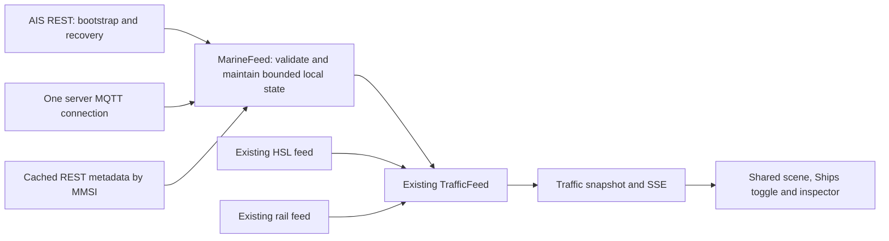

# Milestone F Live ship layer

**Status:** Planned — 9 October 2026
**Depends on:** Existing city scene and traffic snapshot/SSE delivery from B–E; preserve the current rail integration.
**Task:** Add observed Digitraffic AIS vessels to Helsinki Lens through REST bootstrap and MQTT updates. Follow [the implementation plan](../implementation-plan.md) and [marine feasibility research](../digitraffic-marine-feasibility.md).

## Outcome and scope

A user opens the Harbour view, enables Ships, sees recently reported vessels at their reported coordinates, selects one by pointer or keyboard, and reads its name, broad type, navigation status, motion values, source and reporting age. Updates come from real AIS reports. When reports stop, motion stops; source failures and stale positions remain distinguishable.

Use the current release bounds `[24.86, 60.135, 25.06, 60.225]`, the existing water surface, lightweight schematic markers and the existing traffic endpoints. Ships start enabled alongside the other vehicle modes and have their own toggle. The transit route filter applies to transit only; it must not hide enabled ships. The current bounds exclude Vuosaari.

This milestone covers the live layer only. Portnet/NEMO schedules, arrival predictions, berth placement, historical tracks/replay, a Vuosaari map expansion and realistic dimensioned hull models belong to later work. No database, new broker, new runtime dependency or new per-browser upstream connection is needed. Implementation does not include production deployment.

## Architecture and fixed decisions

- Add a concrete `MarineFeed` beside `RailFeed`, using the same start/listener/stop lifecycle shape. Extend `TrafficFeed` explicitly; do not introduce a general provider framework.
- Keep MQTT on the Node server using the installed `mqtt` dependency. Use `wss://meri.digitraffic.fi:443/mqtt` and the verified topics `vessels-v2/+/location`, `vessels-v2/+/metadata`, `vessels-v2/status`. The location topic is singular. Wildcard messages cover more than Helsinki; discard irrelevant positions after validation.
- Seed positions through `/api/ais/v1/locations?latitude=60.18&longitude=25&radius=15&from=<epoch-ms>`, with `from` set to the beginning of the 30-minute retention window. Apply the exact release bounds locally. Use the same area during reconnect recovery.
- Fetch `/api/ais/v1/vessels/{mmsi}` for newly observed local MMSIs through a bounded cache/queue. MQTT metadata updates that cache for known local vessels. Skip national metadata polling; a valid unnamed ship is immediately usable with an MMSI label.
- Use the existing `/api/traffic` and `/api/traffic/stream` responses. Add optional `sources.marine` and retain existing HSL/rail semantics; do not reinterpret the legacy top-level `status` as proof that every source is live.
- Preserve HSL and AIS identities separately. No proximity/name matching and no blanket passenger-ship suppression. The initial layer can show overlapping HSL/AIS reports with source badges; counts are labelled as reports, not a deduplicated physical fleet. Only introduce specific ferry suppression if a reviewed, cited HSL owner/vehicle-to-MMSI mapping is actually established during implementation. With such a mapping, prefer fresh HSL and allow AIS fallback when HSL expires. Do not create an empty mapping framework.

## Data contract

Extend the existing `Vehicle` with mode `ship`, `sourceId: 'digitraffic-marine'`, `id: 'ais:<mmsi>'`, and a small optional `marine` summary. Keep existing `reportedAt` for normalized position record time and `receivedAt` for that position's local receipt time. Allow `routeId: null` and leave journey/operator/deviation fields null for ships; audit all callers that currently assume route IDs are strings. Add `ship` to the existing mode union without a project-wide naming refactor.

The marine summary carries canonical MMSI, nullable IMO/name/call sign/type/navigation status, course over ground, position accuracy/RAIM when supplied, metadata update/receipt times, and motion/quality flags needed by the renderer. The shared speed stays metres/second; ship details can format knots. Keep a valid true heading distinct from course. Omit packed AIS ETA, turn-rate animation and ship dimensions from the first UI because they are not needed for the selected outcome.

| Source field | Boundary rule |
|---|---|
| REST `properties.timestampExternal` | Epoch milliseconds → `reportedAt`; REST `properties.timestamp` is second-of-minute/status, never epoch time. |
| MQTT location `time` | Epoch seconds → milliseconds exactly once → `reportedAt`. |
| REST/MQTT metadata `timestamp` | Epoch milliseconds → metadata update time; never refreshes position age or position receipt time. |
| MQTT status `updated` | Epoch seconds → marine feed update time; never refreshes individual vessels. |
| MMSI | Require an integer identifier in the documented range and canonical nine-digit string; validate the topic and agreement between REST feature/property IDs. No arbitrary numeric coercion or fabricated padding to rescue malformed IDs. |
| Coordinates | Finite WGS84 values in range; reject missing values and `181/91` sentinels before area filtering. |
| SOG/COG/heading | Missing values become null. SOG `102.3`, COG `360`, heading `511` are unavailable; capped SOG `102.2` is not usable for motion. Validate remaining ranges, convert valid knots by `1852/3600`. |
| Other quality | Validate enums/booleans explicitly; do not copy the schema's erroneous boolean enum. REST position-second codes 61/62 carry manual/estimated flags; 63 is not an animatable fix. MQTT omits that raw field, so absence remains unknown. |
| Text/IMO | Bound strings, trim AIS padding, render as text; blank values and IMO zero remain unknown. Validate nonzero IMO format/check digit before treating it as an identifier. A bad optional metadata field must not discard a valid position. |

Discard malformed positions, future record times more than five seconds ahead, and older position revisions. Validate metadata independently; reject its older revisions without replacing useful existing metadata. Because MQTT truncates position time to seconds while REST retains milliseconds, equal-second REST/MQTT records require a deterministic policy: prefer the more precise REST record within that second, treat identical records as duplicates, and never animate conflicting same-second samples. A later-second MQTT report wins. No refresh or reconnect may move a vessel backwards in record time.

## Initial operating policy

These are application defaults to verify during acceptance, not provider guarantees. Define them once and use them consistently in server expiration, browser lists, the inspector and `ReceivedPositions`.

| Concern | Initial policy |
|---|---|
| Moving or unknown-status ship | Stale at 2 minutes; removed from scene at 10 minutes. |
| Anchored/moored ship | Use the longer policy only when navigation status is anchor/moored and valid SOG is at most 0.5 knots: stale at 10 minutes; removed at 30 minutes. |
| Stale or disconnected display | Hold the last position, show age and source status. Feed disconnect never resets vessel clocks. Selection retains a dated removed/out-of-coverage explanation. |
| Interpolation | Start with a 10-second report-time buffer, at most 64 points covering a 30-second window plus one preceding point. No extrapolation. Reduced motion shows the latest accepted position. |
| Discontinuity | No interpolation across gaps over 30 seconds or distances over 1 km. A short-gap displacement implying over 40 m/s is rejected/flagged rather than animated; long gaps restart the track at a valid new report. Thresholds may be revised only with recorded evidence. |
| Orientation | Use valid true heading; otherwise COG only with SOG above 0.5 knots. Unknown orientation uses a nondirectional marker, not an invented north-facing bow. |
| REST | Fixed upstream URLs, gzip and `Digitraffic-User: HelsinkiLens/1.0`; 12-second timeout, 8-MiB decoded-byte cap, no redirects. One bootstrap/recovery request in flight; recovery requests at least 60 seconds apart. |
| REST fallback | While MQTT is unavailable, refresh positions at most once per minute and label the source as periodic/degraded. Stop fallback polling when live recovery succeeds. Metadata failure does not disable positions. |
| Metadata | At most two lookups in flight and 20 starts/minute; cache successful lookups for six hours, misses/failures for 15 minutes, with newer MQTT metadata applied immediately. Queue at most 250 known local MMSIs; no arbitrary user-triggered upstream URL. |
| MQTT reconnect | One socket/attempt per process; 15/30/60-second delays plus nonnegative jitter, with a unique application client ID. This avoids rapid retry loops against the documented connection-request limit. Reset backoff only after a healthy subscription. |
| Quiet connections | Track receipt of broker messages and source status separately from local positions. A quiet Helsinki fleet is valid. Replayed status with an old `updated` value does not establish upstream freshness. If no valid status/message arrives for two minutes, mark marine stale/disconnected and recover. |
| State budgets | At most 250 active local ships, 500 metadata cache entries and 1,000 recent identity/version records. Evict expired/old entries; if active capacity is exhausted, report the limit and rejected additions instead of silent truncation. |
| Input budgets | 32-KiB individual MQTT payload; initial aggregate caps of 1,000 messages/s and 1 MiB/s. Drop/count invalid or excess input and surface degraded status. Measure national wildcard throughput before finalizing these limits. |
| Delivery/lifetime | Reuse one-second traffic coalescing, bounded removal/full-snapshot recovery, 1-MiB per-client SSE queue and 30-second last-consumer idle shutdown. Hidden tabs continue using the existing disconnect/resume behavior. |

Keep HSL and rail freshness/interpolation unchanged. Preserve HTTP status and `Retry-After` on upstream errors if needed through a small compatible extension of `server/io.ts`; never parse an error body as vessel data. Honour a valid longer retry delay on 429/503. New limits stay source-local constants rather than a configuration system.

## Implementation sequence

Complete F1 → F2 → F3 → F4 → F5. Each step includes its focused tests; F5 verifies the integrated result. Estimates total approximately 4–6 working days for one developer familiar with this codebase, excluding waiting for representative live traffic.

### F1 — Contracts, decoder and fixtures (0.5–1 day)

**Files:** new `src/lib/marine.ts`, `src/lib/data/marine.ts`, `tests/marine.test.ts`, `tests/fixtures/marine/`; update `src/lib/types.ts`, `traffic.ts` and affected type callers.

Implement separate REST-position, MQTT-position and metadata decoders with a shared normalized result. Keep source/time provenance sufficient to apply the equal-second policy. Add the source-specific freshness functions used later by both feed and UI. Use small attributable fixture excerpts from the research or a new bounded capture; label synthetic mutations explicitly and keep ordinary tests offline.

**Gate:** tests prove each timestamp unit, feature/topic identity validation, null/sentinel treatment, independent metadata revisions, future/out-of-order rejection, plausible motion and all freshness boundaries. Existing transit fixtures still decode unchanged. Null route identity produces no invented journey.

### F2 — Demand-driven MarineFeed (1–1.5 days)

**Files:** new `src/lib/server/marine-feed.ts`, `tests/marine-feed.test.ts`; reuse `server/io.ts`, with `tests/io.test.ts` changed only if error metadata is extended.

Start the MQTT subscription and REST bootstrap without making one depend on the other's success. Merge into latest state by record time; a delayed REST response cannot overwrite a newer MQTT report. Queue metadata only for relevant MMSIs and keep unnamed positions visible. Support REST failure with working MQTT and MQTT failure with working REST independently.

Track newer out-of-bounds reports as bounded recent version/tombstone records so an older bootstrap cannot resurrect a ship that left the scene. A successful REST response is a set of dated observations, not an authoritative fleet deletion event; expire missing vessels by their clocks. Invalidate callbacks from previous connection/lifetime generations, and cancel timers, HTTP and subscriptions on stop.

Expose connection state, last source message/update, last local position, last successful snapshot, errors and bounded diagnostic counts. Broker connectivity and an empty local area must be distinguishable from an upstream error. Inject transport/fetch/clock dependencies using existing testing patterns.

**Gate:** deterministic tests cover both startup races, same-second REST/MQTT overlap, metadata-before-position, failed subscription, 429 retry, reconnect storms, stale heartbeat, late callbacks after stop, area exit/re-entry, eviction and invalid-message floods. One start/stop cycle leaves no active handles or requests.

### F3 — Shared traffic delivery (0.5–1 day)

**Files:** `src/lib/server/traffic.ts`, `src/lib/traffic.ts`, `tests/traffic.test.ts`, and existing traffic verification code where its expectations change.

Wire one `MarineFeed` into the existing singleton lifecycle. Merge its changes/removals into the shared pending maps and include `sources.marine` in snapshots and updates. Coalesce repeated updates and retain the existing slow-client disconnect/full-snapshot recovery policy. Include marine counts in diagnostics without changing what existing HSL/rail counters mean. Measure the complete combined snapshot at the supported source maxima against the 1-MiB SSE queue: compact optional metadata or lower the documented marine capacity if necessary. An oversized valid snapshot must not trap clients in a reconnect loop.

Apply marine expiration without the global 120-second transit cutoff accidentally removing stationary ships. Keep HSL/rail records and errors isolated: one provider reconnecting, emitting a snapshot or clearing pending state must not lose another provider's update. Make clients tolerate optional marine status, including snapshots produced before the new source is ready.

**Gate:** two browser consumers share one marine socket and one metadata cache. A slow/disconnected consumer does not grow queues; a full snapshot at the supported maximum source counts fits the delivery budget. Marine REST/MQTT failure leaves HSL and rail usable, and the reverse holds. Recovery snapshots contain the combined latest state; final consumer release shuts everything down after the existing grace period.

### F4 — Rendering, selection and source UX (1–1.5 days)

**Files:** `src/lib/live-fleet.ts`, `scene.ts`, `vehicle-flags.ts`, `inspection.ts`, `rail.ts`'s existing shared vehicle-label helper, `route-context.ts` callers, `components/CityScene.svelte`, `src/routes/+page.svelte`, and a small `components/MarineVesselDetails.svelte` if it keeps the existing inspector pattern clearer. Add CSS only where needed.

Add the ship mode to all mode records, layer controls and instancing loops. Render a schematic water-surface marker at the AIS position; use an orientation cue only when valid. Do not load every ship through the small-transit GLB validator or change its 60-metre/15-metre limits. Keep camera follow, picking, screen labels and resource disposal on the existing paths.

Update every browser expiry path, particularly `availableVehicles`, stale counts and `ReceivedPositions.position`. Handle null route IDs in sorting, labels, search and flags. Search ships by name/MMSI/call sign. Selecting a ship must clear obsolete route geometry and produce a null journey request; no HSL or rail API call should be issued. Ship visibility is independent of transit route filtering.

Show name or MMSI fallback, broad type, MMSI/valid IMO, speed/course/heading when known, navigation status, position age/time, metadata age/time, quality and independent marine source state. Use Europe/Helsinki display time. Show the deliberate animation buffer as display delay rather than claiming exact current position. Labels/counts distinguish fresh reports, stale reports, empty coverage, periodic fallback and failure. Add Fintraffic attribution and the Class A/partial-coverage explanation to the source drawer.

Use the existing keyboard object browser, focus transitions, narrow-screen inspector and reduced-motion behavior. Validate edited Svelte components with the project's Svelte tools during implementation.

**Gate:** pointer and keyboard select the same ship; the list/inspector works without WebGL; no ship appears on terrain or receives a fabricated transit route/delay. Missing metadata, unknown orientation, stale/removed selection, route filtering and reduced motion have explicit tested behavior. Existing train/tram/bus/ferry views pass regression checks.

### F5 — Integrated verification and operating evidence (0.5–1 day, plus live observation windows)

**Files:** extend relevant `tests/live-fleet.test.ts`, `vehicle-flags.test.ts`, `scene.test.ts`, `inspection.test.ts` and route/UI tests; new bounded `scripts/verify-marine.ts` following `scripts/verify-traffic.ts`; update `README.md`, `docs/data-contracts.md`, `docs/data-access.md`, `docs/operations.md`; write `docs/milestone-results/F.md` when work is performed.

The live verifier has duration/byte/message caps and records UTC observation times, endpoint/topic, local counts, reporting-age distribution, metadata-match coverage, rejected fields, source recoveries and payload volume. It must not claim that a zero-count window proves no ships. Keep full national payloads out of Git and logs; only small attributable fixtures belong in the repository.

Run focused offline tests after each step. At integration completion run `rtk npm run check`, `rtk npm test` and `rtk npm run build` once, then repeat only checks affected by fixes. Manually verify desktop/mobile, reduced motion, tab hiding/resume, WebGL-unavailable mode and two simultaneous clients.

Observe a real moving vessel across several reports, a quiet/moored set and a controlled upstream interruption/recovery. Perform a 30-minute representative soak and a separate twice-observed-peak fixture load. Retain the shared targets: at least 30 FPS on the documented baseline and p95 internal receipt-to-browser delivery below two seconds, reported separately from provider age and the intentional animation buffer. Record bounds, browser/hardware, counts, memory/queue trend and outcomes. No live availability is required for the normal test suite.

**Gate:** evidence marks each acceptance item pass/fail/blocked. Missing moving-vessel evidence or unresolved performance regressions remain open rather than being covered by stationary samples or synthetic motion.

## Acceptance checklist

- [ ] Fresh, validated AIS positions appear within the current bounds; absent metadata does not hide a valid ship.
- [ ] REST/MQTT clocks, raw AIS second codes and metadata/feed clocks remain distinct through the UI.
- [ ] Replayed or delayed REST data cannot overwrite newer updates or resurrect an exited ship.
- [ ] Marine stale/removal policy agrees in server, scene, object list and inspector; HSL/rail policy is unchanged.
- [ ] Interpolation uses plausible received reports only, stops at the last report and respects reduced motion and unknown orientation.
- [ ] Ship selection/search/filtering works by keyboard and pointer without GTFS requests, fake routes or transit delay labels.
- [ ] Snapshot/SSE delivery is shared and bounded; REST, MQTT, HSL and rail failures remain independent and visible.
- [ ] Metadata lookup, reconnect, retained state and client queues remain within measured limits; idle shutdown cleans up resources.
- [ ] Coverage, source attribution, animation delay and any unresolved HSL/AIS overlap are visible and documented. No deduplicated harbour inventory is claimed.
- [ ] Real moving and stationary observations, recovery, two-client behavior, 30-minute soak, accessibility and performance have dated evidence.
- [ ] Type checks, relevant regressions and the production build pass; changed files and unresolved findings are recorded in the F results.

## Execution notes and handoff

The working tree already contains unrelated city, energy and rail changes. Inspect current code and test baselines before implementation, preserve those changes, and recheck shared integration points if they evolve. In particular the rail code already has its own source lifecycle and motion buffer; do not replace it with an older research snapshot. Benchmark scratch files are not production integration targets.

Release this as a single coherent application change after all gates pass. A failure in a live gate blocks that claim, not unrelated offline checks. Use the normal application version rollback if integration causes a regression; no database or asset migration is introduced. Deployment is a separate action.

The next optional milestone is a harbour board with Portnet and NEMO normalization. It can consume these vessel IDs and clocks later; this milestone adds no schedule parser, guessed berth position or speculative schedule UI.
